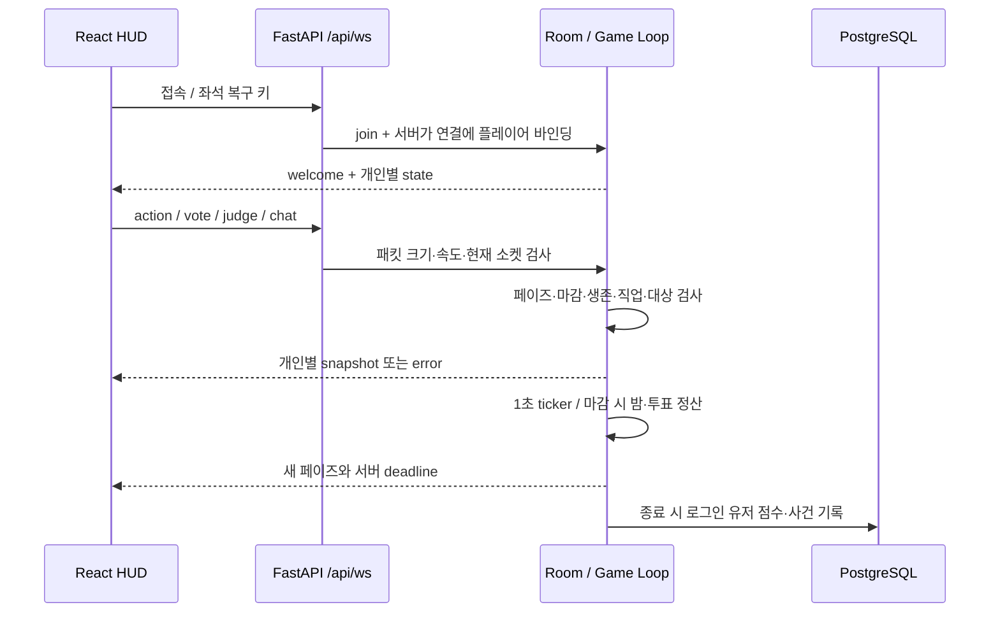

# 검은 자정: 게임·통신·HUD 설계

기존 서비스는 **Next.js / React + FastAPI WebSocket + PostgreSQL**이다. 이번 개선은 이 스택을 유지한다. 아래 Node.js / Socket.IO 코드는 요구한 엔진 구조를 보여 주는 **참고 구현**이며, 배포 서버의 실행 코드가 아니다. 완전한 무중단 통신이나 외부 음성방의 스포일러 차단을 보장하지 않는다.

## 1. 실제 요청과 상태의 흐름



1. `frontend/lib/ws.ts`가 같은 origin의 `/api/ws`에 연결한다. 20초 ping, 500ms부터 최대 8초까지 jitter가 있는 재접속을 사용한다.
2. `backend/app/routes/ws.py::game_socket`이 연결을 좌석에 바인딩한다. 새 연결이 기존 좌석을 복구하면 이전 소켓을 교체한다. 이전 연결의 종료 처리로 새 좌석을 끊지 않는다.
3. `backend/app/game.py::Room`이 유일한 실시간 게임 권위다. 클라이언트는 결과나 직업을 쓰지 않고 의도만 보낸다. 잘못된 페이즈·사망자·잘못된 대상·마감 이후 결정은 서버가 거부한다. action/vote/judge에는 매 단계 새로 생성되는 phase_id가 필수이며, 오래된 요청에는 최신 개인 상태를 다시 보낸다.
4. `_ticker → _advance → _resolve_*`가 정산한다. 브라우저의 카운트다운은 server_now + performance.now() 경과 시간을 사용하며 서버 deadline이 실제 마감이다.
5. `_state_for(viewer)`가 직업·마피아 동료·탐정 결과·봉인 투표를 수신자별로 필터링한다. 비밀을 전체 방에 보낸 뒤 CSS로 숨기지 않는다.
6. `models.py`, `routes/leaderboard.py`, `services/passport.py`가 종료 점수와 수사관 진행 기록을 저장한다. 진행 중 방과 채팅은 메모리 상태이며 DB에 실시간 저장하지 않는다.

## 2. 현재 FSM과 판정 규칙

```text
lobby → reveal → night → dawn → day → vote
                                    vote → defense → verdict → result → night
                                    vote 동률/표 없음 → result
밤·판결 정산 후 승리 조건 충족 → gameover → rematch → lobby
```

| 결정 | 현재 서버 규칙 / 근거 |
| --- | --- |
| 밤 행동 | `act`: 마피아·의사·탐정·경호원만 가능. 마피아 동료 공격, 탐정·경호원의 자기 선택 금지 |
| 밤 정산 | `_resolve_night`: 마피아 표 최다 대상 → 의사 보호 확인 → 경호원이 대신 사망 → 일반 사망. 탐정 결과는 본인에게 전달 |
| 여러 공격·치료 | 현재 마피아 동률은 수집 순서에 영향을 받는다. 의사가 여러 명이면 마지막 치료 대상 하나를 사용한다. 다중 직업 확장 전에 명시적 규칙 필요 |
| 시민 투표 | `vote`: 생존 타인만 선택. 최다 득표가 단독일 때만 최후 변론 진행; 동률·표 없음은 처형 없이 종료 |
| 기권 | `vote target="skip"`으로 명시적 기권 가능. 완료 인원에 포함하지만 피고 후보 득표에서는 제외. 마감까지 미제출도 기권 |
| 최후 변론 | `add_chat`: 피고인만 공개 발언. 종료 후 처형 찬반 `judge`; 피고인은 판결 투표 불가 |
| 판결 | `_resolve_verdict`: 제출된 찬성이 반대보다 많아야 처형. 동률은 석방; 미제출은 집계에서 제외 |
| 승리 | `_check_win`: 마피아 0명은 시민 승리, 마피아가 나머지 생존자 이상이면 마피아 승리. 광대는 시민 처형 시 단독 승리 |

전체 선택이 완료되어도 최소 숙고 시간이 지나야 조기 전환한다. `first`, `quick`, `classic` 속도별 타이머는 `PACE_SECONDS`와 `EARLY_ADVANCE_MINIMUM`에서 관리한다. 결정 교체는 마감 전까지 허용하고, 재접속 후 서버 snapshot으로 HUD를 복구한다.

## 3. Node.js / Socket.IO 엔진 참고 코드

아래는 보호 → 공격 우선순위, 페이즈 세대 검증, 동률·기권·변론 흐름을 담은 작은 예제다. 실제 서버의 경호원·탐정·광대·승리 조건·지속 저장은 생략했다. 이 예제의 공격 동률은 공격 없음으로 처리하므로 현재 Python 엔진과 규칙이 다르다.

```ts
type Phase = "night" | "day" | "vote" | "defense" | "verdict";
type Seat = { id: string; role: "citizen" | "doctor" | "mafia"; alive: boolean };
type Command = { epoch: number; target?: string | null; execute?: boolean };
const seconds: Record<Phase, number> = { night: 70, day: 180, vote: 75, defense: 60, verdict: 55 };
function uniqueLeader(ids: string[]) {
  const counts = new Map<string, number>();
  ids.forEach(id => counts.set(id, (counts.get(id) ?? 0) + 1));
  const sorted = [...counts].sort((a, b) => b[1] - a[1]);
  return sorted[0] && (!sorted[1] || sorted[0][1] > sorted[1][1]) ? sorted[0][0] : null;
}
class Engine {
  phase: Phase = "night"; epoch = 1; accused: string | null = null;
  deadline = performance.now() + seconds.night * 1000;
  actions = new Map<string, string>(); votes = new Map<string, string | null>();
  verdicts = new Map<string, boolean>();
  constructor(public seats: Map<string, Seat>) {}
  enter(phase: Phase) {
    this.phase = phase; this.epoch++; this.deadline = performance.now() + seconds[phase] * 1000;
  }
  accept(id: string, kind: "action" | "vote" | "judge", cmd: Command) {
    const actor = this.seats.get(id), target = cmd.target ? this.seats.get(cmd.target) : undefined;
    if (!actor?.alive || cmd.epoch !== this.epoch || performance.now() >= this.deadline) return false;
    if (kind === "action" && this.phase === "night") {
      if (!target?.alive || !["doctor", "mafia"].includes(actor.role)) return false;
      if (actor.role === "mafia" && target.role === "mafia") return false;
      this.actions.set(id, target.id); return true;
    }
    if (kind === "vote" && this.phase === "vote") {
      if (cmd.target !== null && (!target?.alive || target.id === id)) return false;
      this.votes.set(id, target?.id ?? null); return true; // null = 명시적 Skip
    }
    if (kind === "judge" && this.phase === "verdict" && id !== this.accused && typeof cmd.execute === "boolean") {
      this.verdicts.set(id, cmd.execute); return true;
    }
    return false;
  }
  advance() {
    if (performance.now() < this.deadline) return;
    if (this.phase === "night") {
      const protectedIds = new Set<string>(), attacks: string[] = [];
      for (const [id, target] of this.actions) {
        const actor = this.seats.get(id);
        if (!actor?.alive || !this.seats.get(target)?.alive) continue;
        if (actor.role === "doctor") protectedIds.add(target);
        if (actor.role === "mafia") attacks.push(target);
      }
      const victim = uniqueLeader(attacks);
      if (victim && !protectedIds.has(victim)) this.seats.get(victim)!.alive = false;
      this.actions.clear(); this.enter("day");
    } else if (this.phase === "day") {
      this.votes.clear(); this.enter("vote");
    } else if (this.phase === "vote") {
      this.accused = uniqueLeader([...this.votes.values()].filter((id): id is string => id !== null));
      this.enter(this.accused ? "defense" : "night");
    } else if (this.phase === "defense") {
      this.verdicts.clear(); this.enter("verdict");
    } else {
      const yes = [...this.verdicts.values()].filter(Boolean).length;
      if (this.accused && yes > this.verdicts.size - yes) this.seats.get(this.accused)!.alive = false;
      this.accused = null; this.enter("night");
    }
  }
}
```

Socket.IO 바인딩은 인증 미들웨어에서 얻은 좌석 ID를 사용한다. 클라이언트가 보낸 actor/role을 신뢰하지 않는다. 다음 예제는 `authorizedRoom`, `parseCommand`, `rateLimit`, `publishPrivateViews`를 서비스 계층에서 제공한다는 전제다.

```ts
io.on("connection", socket => {
  const engine = authorizedRoom(socket.data.session); // 인증 + 방 멤버십 검증
  socket.on("command", (raw, ack) => {
    const cmd = parseCommand(raw); // 엄격한 enum·길이·타입 검증
    if (!cmd || !rateLimit(socket.id)) return ack?.({ ok: false });
    const ok = engine.accept(socket.data.session.seatId, cmd.kind, cmd);
    ack?.({ ok, epoch: engine.epoch });
    if (ok) publishPrivateViews(engine); // 연결별 허용된 DTO만 emit
  });
});
```

방 하나의 명령과 tick은 하나의 직렬 실행 경로에서 처리한다. 비동기 DB 호출을 엔진 상태 변경 사이에 끼우지 않는다. 실서비스에는 command ID 기반 중복 제거·ack·재접속 snapshot·방 종료 시 timer 해제가 필요하다. Socket.IO는 기본적으로 끊긴 동안의 이벤트를 자동 영속화하지 않는다. [공식 전달 보장](https://socket.io/docs/v4/delivery-guarantees/), [서버 API](https://socket.io/docs/v4/server-api/).

## 4. 모듈식 직업 확장안

현재 Python은 `ROLE_NAMES`, `act`, `_resolve_night`, `_check_win`, `_state_for`에 직업 분기가 있다. 새 직업을 등록만으로 추가할 수 있는 구조는 후속 설계이며, 아래 계약으로 분리할 수 있다.

```ts
interface RoleModule {
  id: string;
  faction: "citizen" | "mafia" | "neutral";
  priority: number; // 예: 방해 10 → 보호 20 → 공격 30 → 조사 40
  validate(ctx: Readonly<ActionContext>, target: string): string | null;
  resolve(ctx: Readonly<NightContext>, target: string): Effect[];
  privateView(ctx: Readonly<ViewerContext>): PrivateRoleView;
  wins(ctx: Readonly<EndContext>): boolean;
}
```

모듈은 전체 Room을 직접 변경하지 않고 `protect`, `kill`, `redirect`, `privateIntel` 같은 Effect를 반환한다. 엔진이 우선순위와 안정적인 ID 순으로 정산하고 결과 DTO를 생성한다. 정치인·영매·청소부·스파이·연쇄살인마·광인·테러리스트는 아직 실제 플레이 직업이 아니다. 각 직업마다 대상 검증, 사망 시 행동 취소 여부, 능력 충돌, 승리 조건, 비밀 노출 테스트와 밸런스 검증이 필요하므로 ‘5분 안에 완성’은 보장하지 않는다.

## 5. React HUD와 시각·사운드 구성

```text
GameRoom [현재 app/page.tsx / CSS phase-*]
├─ PhaseHeader       단계 이름 · 남은 시간 · 연결 상태
├─ RoomStage         느와르 배경 · 플레이어 · 투표/밤 행동 대상
├─ CasePanel         사건 기록 · 공개 단서 · 수사 메모
├─ ChatPanel         허용 채널 · 읽지 않은 대화 · 입력 상태
├─ RolePanel         내 비공개 직업 · 능력 · 개인 조사 결과
├─ AfterlifePanel    사후 예측 · 허용된 사후 메시지
└─ ActionDock        한 단계의 핵심 행동 · 선택 확인 · 모바일 안전 영역
```

기존 구현의 패널을 설명하는 구조이며 모든 항목이 별도 파일로 추출된 컴포넌트는 아니다. 모바일은 사건·수사·대화·내 정보 탭으로 분리하고 데스크톱은 테이블과 대화의 동시 열람을 우선한다. 주 행동은 한 번에 하나, 선택 대상과 전송 상태는 따로 표시한다. 버튼은 44px 이상, 긴 한국어는 `keep-all`과 `min-width: 0`, focus-visible과 live 상태 안내를 유지한다.

밤은 청회색, 낮은 따뜻한 회색, 투표는 절제된 적색을 사용한다. 단계 색만으로 의미를 전달하지 않고 이름·아이콘·가이드를 함께 표시한다. 배경 효과는 텍스트 위를 가리지 않고 `prefers-reduced-motion`과 문서 visibility를 따른다. 저사양 모바일에서 지속적인 전체 화면 blur와 고해상도 canvas는 피한다.

`page.tsx`의 Web Audio 효과음과 브라우저 음성 아나운서는 사용자 조작 후 재생하며 설정에서 독립적으로 끌 수 있다. 현재는 페이즈 전환 큐와 마감 직전 경고음을 하나의 AudioContext에서 합성한다. 밤의 지속 저음 드론과 심박 BGM을 추가할 때는 별도 gain/음량 설정과 음성 참여 중 ducking을 적용하는 설계를 권장한다. 지속 BGM과 별도 BGM 음량은 이번 구현에 포함하지 않는다. phase당 하나의 전환 큐만 재생하고 oscillator·timer·gain을 정리한다. 실제 음악 파일을 추가할 때는 이용권한 확인이 필요하다.

## 6. 관전·치팅 방지와 운영 한계

현재 사망자에게는 사후 예측, 제한된 유령 메시지와 유령 전용 비밀 대화가 있다. 전체 직업 공개는 `gameover`에서만 한다. 유령 채널은 사망/관전자 자격·길이·속도를 서버에서 검사하고 생존자에게 보내지 않는다. 경쟁 모드의 사망자에게 모든 생존자의 정체를 실시간 공개하면 외부 전달이 쉬워진다. 전원 동의한 캐주얼 전지적 관전 또는 게임 종료 후 역할 리플레이로 제한하는 것이 안전하다.

Discord·대면 대화·화면 공유의 정보 유출은 웹 서버가 기술적으로 차단할 수 없다. 익명 매칭, 종료 전 직업 비공개, 관전 지연, 신고·차단·운영 정책은 피해를 줄이는 수단이다. 금지어만으로 스포일러가 완전히 제거되었다고 표시하지 않는다.

현재 음성은 `frontend/lib/voice.ts`의 WebRTC P2P이며 WebSocket은 SDP/ICE를 중계한다. STUN만 설정되어 있어 일부 NAT·사내망에서 실패할 수 있다. TURN relay·단기 자격증명·SFU는 현재 제공하지 않는다. 마이크 비활성화는 UI 정책이며 변조 클라이언트까지 강제할 수 없으므로 경쟁전의 강제 발언 권한은 서버가 미디어를 중계하는 SFU가 필요하다.

## 7. 성능과 확장 경계

현재 일반 명령은 120ms, 채팅은 450ms 간격으로 제한하고 패킷은 8,192자로 제한한다. 채팅·이벤트는 유한 `deque`, 송신은 개인 snapshot 캐시·동일 payload 생략·broadcast lock·느린 소켓 timeout을 사용한다. 메시지를 debounce로 합쳐 삭제하지 않고, 화면 렌더링과 입력 중 표시만 프레임 단위로 합친다.

방은 프로세스 메모리에 있기 때문에 재시작 시 진행 게임이 사라진다. 동일 방의 연결이 서로 다른 API 인스턴스로 분산되면 상태가 분리된다. 수평 확장 전에는 room owner routing과 단일 방 writer, 영속 snapshot/event log, 복구 epoch를 도입해야 한다. 단순히 Redis pub/sub를 붙이는 것만으로 게임 정합성이 생기지 않는다.

검증 근거는 `backend/tests/test_game_flow.py`, `test_ws.py`, `test_theory.py`와 실제 브라우저 플레이 흐름이다. 부하 수용량과 턴 지연 보장은 실제 동시 연결·채팅·느린 클라이언트 부하 시험 후에 수치로 제시한다.

## 이번 개선의 실제 추가 프로토콜

- `join_only=true`: 기존 방만 조회, 없으면 HTTP101 후 close4007. 새 방 생성은 기본 연결을 사용한다.
- `phase_id` / `server_now`: 매 페이즈 토큰과 서버 시각. action/vote/judge는 현재 토큰을 반드시 포함한다.
- `vote target="skip"`: 완료 인원에 포함하는 기권. 다른 후보만 비교하고 동률이면 피고가 없다.
- `ghost_chat`: 사망자/관전자만 쓰고 읽는 대화. 160자·0.45초 제한·최대80개, 재경기 초기화. 생존자/생존 마피아에게 전송되지 않는다.
- `voice_scope`: 페이즈·연결 세대와 채널을 결합한다. 서버의 개인별 허용 참가자와 함께 확인하고 바뀌면 기존 WebRTC peer/미디어/ICE 큐를 종료한다.
