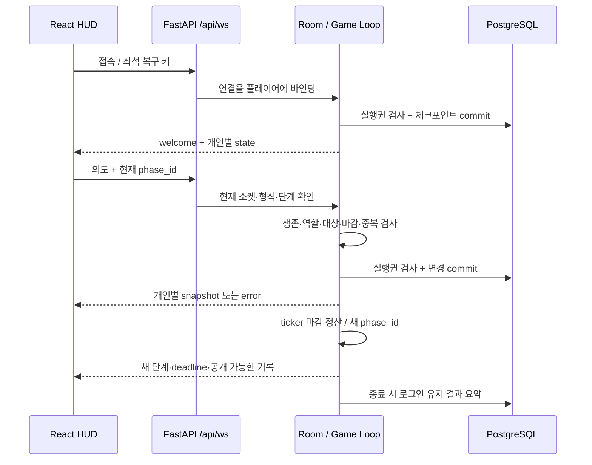

# 검은 자정: 게임·증거·통신 설계

이 문서는 2026-11-22 개편 코드의 책임 경계와 공개 범위, 판정·실패 조건을 설명한다. 빌드 성공, 테스트 성공, 배포 플랫폼의 `ready`, 실제 운영 여정과 사용자 반응은 서로 다른 증거다. 이 문서 자체가 특정 커밋의 출시 완료나 무결함을 보증하지 않는다.

실제 스택은 **Next.js 16 / React 19 정적 프런트엔드 + nginx + FastAPI WebSocket + PostgreSQL**이다. 이번 변경은 다른 엔진으로 이관하지 않는다. 봇은 Python 규칙·템플릿 기반이며 외부 유료 LLM을 호출하지 않는다. 화면의 구체적인 시각 설계는 [design.md](../design.md), 설치·환경 변수·실행 명령은 [README](../README.md)를 참고한다.

## 1. 우선 사용자 여정과 바꾸지 않는 것

```text
혼자 첫 사건 / 친구 방 진입
  → 역할 확인 → 밤의 최종 선택 → 서버 정산
  → 공개 사건 보고와 개인 결과 확인
  → 공식 진술 → 공개 기록을 인용한 질문 → 해명 또는 판단 수정
  → 용의자 투표 → 최후 변론 → 처형/석방 판결
  → 승패 확정 → 실제 행동 복기 / 사건 리포트 / 로그인 유저 진행 기록
```

개선의 목적은 기능 개수보다 **무엇이 확인된 사실인지, 누가 무엇을 주장했는지, 다음에 무엇을 판단해야 하는지**를 분리하는 것이다. 인용 질문과 답변은 토론 기록이며 자동 유죄 판정이 아니다. 타임라인 역시 관찰하지 않은 시민 이동이나 역할별 이동 시간을 지어내는 장치가 아니다.

기존 솔로/친구 모드, 역할 능력, 사망자 채널, 호스트 복구, WebRTC 범위 검사, 수사관 패스포트는 보존한다. 후속 복구 변경은 운영의 서버 전용 체크포인트를 PostgreSQL에 저장한다. 진행 중 솔로 방에 친구를 합류시키거나 영구 영상 리플레이를 만드는 기능은 아니다. 무료 범위의 실제 목표·대안·한계는 [복구 설계](RESILIENCE.md), 부하 방법은 [용량 검증](CAPACITY_TEST.md)에 둔다.

## 2. 구현 책임과 저장 경계

| 경로 | 책임 | 보장하지 않는 것 |
| --- | --- | --- |
| `backend/app/game.py::Room` | 방·페이즈·권한·정산·개인별 상태·게임 내 기록의 권위, 변경 잠금과 저장 경계 | DB 자체 유실·만료된 경기의 복원 |
| `backend/app/routes/ws.py` | 좌석/로그인 바인딩, 패킷·빈도·현재 소켓·phase 검증, 저장 후 state 전송 | 브라우저 send만으로 접수 확정, 게임 명령 자동 재생 |
| `backend/app/models.py`, `services/passport.py` | 로그인 유저의 점수·사건 요약·XP/진행 기록 저장 | 전체 채팅·행동·질문 원문의 영구 리플레이 |
| `frontend/lib/ws.ts` | 연결·재접속·개인 snapshot 수신 | 로컬 send만으로 서버 접수 확정 |
| 게임 HUD와 `CrossExaminationPanel` | 서버 권한과 현재 기록을 표현하고 사용자 의도를 전송 | 자유 문장 진위나 실제 유죄 판정 |

진행은 `Room` 메모리에서 수행하되 운영에서는 allowlist JSON 체크포인트를 저장한다. 마이그레이션0003은 runtime 실행권·체크포인트와 결과 중복 제약을 추가한다. 실행권 owner/epoch/DB 시계 유효성을 쓰기 트랜잭션에서 확인하며 겹친 runtime은 standby로 둔다. 저장소/실행권 오류 시 확정 상태로 되돌리고 재접속 가능한4008로 닫는다. 저장된 명령의 결과도 state를 못 받았다면 클라이언트에서는 미확정이며 재조회가 필요하다. DB 커밋과 네트워크 전송을 하나의 원자적 트랜잭션으로 표현하지 않는다.

## 3. 연결·상태·명령 계약



- 클라이언트는 같은 origin의 `/api/ws`를 사용한다. 재접속에는 지연과 jitter가 있으며, 좌석 복구 뒤 새 소켓이 제어권을 갖는다. 이전 소켓의 종료가 새 연결의 좌석을 끊어서는 안 된다.
- `action`, `vote`, `judge`, `challenge`, `challenge_reply`는 **현재 개인 state에서 받은 `phase_id`**가 필수다. 누락·지난 단계 값은 `stale_phase` 오류와 최신 개인 상태를 반환한다. 클라이언트가 보낸 actor/role/권한은 신뢰하지 않는다.
- 실제 마감은 서버 `deadline`이다. 표시 시간은 `server_now`와 브라우저 monotonic 경과 시간으로 보정한다. 모든 state가 1초마다 새로 수신된다고 가정하지 않는다. 변하지 않은 snapshot은 전송 최적화로 생략될 수 있다.
- 질문·답변의 성공은 수신한 `cross_examinations`에 실제 기록이 있는지로 확인한다. 연결 끊김·응답 지연은 결과 미확정일 수 있다. 로컬 대기 타이머 만료만으로 서버가 거부했거나 취소됐다고 말하지 않는다.
- 현재 빈도 제한은 일부 과도한 요청을 처리하지 않을 수 있다. 모든 명령에 별도 durable request ID/ACK를 도입한 프로토콜은 아니다. UI 잠금이 서버 멱등성을 대신하지 않는다.

## 4. FSM과 기존 정산 의미

```text
lobby → reveal → night → dawn → day → vote
                         ↑                ├─ 피고 없음 → 다음 night
                         │                └─ 피고 있음 → defense → verdict → result
                         └─────────────────────────────────────────────┘
각 정산에서 승리 조건 충족 → gameover
```

| 단계/규칙 | 서버 의미 |
| --- | --- |
| 밤 행동 | 역할·생존·유효 대상·마감 검사 후 해당 배우의 마지막 선택을 사용 |
| 마피아 습격 | 최다 선택 대상, 동률은 기존 `Counter` 수집 순서의 첫 대상 의미를 유지 |
| 치료 | 기존 다중 의사 구현의 마지막 치료 대상 의미를 유지; 새 우선순위를 만들지 않음 |
| 경호 | 해당 보호·희생 규칙을 정산하고 실제 사망자와 습격 대상을 구분 |
| 투표 | 기권도 접수 수에는 포함하되 피고 후보 계산에서 제외 |
| 판결 | `judge`로 처형/석방 의도를 보내며 현재 페이즈와 마감을 다시 검사 |
| 승리/종료 | 기존 진영 승리 조건을 적용; `_finish`는 같은 Room에서 중복 호출 시 재처리하지 않음 |

브라우저의 진행 연출은 페이즈 전환을 안내할 뿐 서버 시계를 늦추거나 판정을 바꾸지 않는다. 일반 실행의 `PACE_SECONDS`와 빠른 E2E fixture의 시간은 별개다. 테스트용 짧은 시계로 실제 초보자 진행 속도가 검증됐다고 해석하지 않는다.

## 5. 확정 밤 원장과 안전한 사건 보고

`_record_night()`는 교체 가능한 클릭 때가 아니라 `_resolve_night()`의 최종 정산에서 기록을 만든다. `night_records`는 최대 32개를 보관한다.

서버 전용 원장에는 아래가 들어간다.

- `id`, `round`, `outcome`, `title`, `detail`
- 최종 선택 `actions[]`: `{actor_id, actor, role, target_id, target, kind}`
- 실제 사망자 `victim_id`, `victim`과 비공개 판정용 `attacker_ids`

`kind`는 `attack | heal | investigate | guard`, `outcome`은 `quiet | attack | rescue | guard`다. 선택 목록은 각 역할의 마지막 선택을 보존한다. 여러 선택 모두가 효과를 발휘했다는 의미는 아니며, 실제 효과는 별도 정산 결과로 읽어야 한다.

일반 snapshot에는 아래 공개 projection만 보낸다.

```ts
type NightSummary = {
  id: string; round: number;
  outcome: "quiet" | "attack" | "rescue" | "guard";
  title: string; detail: string;
} | null;
```

`night_summary`는 **이번 라운드**의 정산 기록이며 `lobby/reveal/night`에는 `null`이다. 새 밤에 이전 밤의 보고를 현재 결과처럼 보여 주지 않는다. 공개된 사망·구조 결과를 넘어서 행동자의 신원·역할·치료/조사 대상·살아남은 습격 대상을 노출하지 않는다. 아무도 사망하지 않은 아침에도 안정적인 ID가 있어 질문의 근거로 인용할 수 있다.

`night_replay`는 종료 전 `[]`, `gameover`에서만 전체 원장을 공개한다. 공개 객체는 위 원장 중 `attacker_ids`를 제외한다. 정산된 선택과 공개 역할로 복기하는 **결과 화면**이지 경기 도중의 전지적 관전이나 URL로 다시 재생하는 영구 리플레이가 아니다. 운영 체크포인트 유효 기간에는 복구되지만 방 정리·만료 뒤 원장을 영구 재생하는 API는 없다.

### 초기 개인 제보는 확정 증거가 아니다

시작 때 생성하는 개인 packet은 첫 실제 밤 행동보다 앞선 **미확인 개인 제보**다. 무작위 서술·후보를 실제 관찰 사실이나 시민의 이동 기록으로 주장하지 않는다. 공개하더라도 검증된 밤 원장·감식 결과와 구분한다. 위조 제보는 같은 형식을 사용하며, 출처와 미확인 상태를 사용자에게 남긴다.

## 6. 타임라인: 정산 단계와 같은 밤의 연결

타임라인의 가시적인 순서는 다음이다.

```text
능력 선택 → 행동 마감 → 실제 정산 결과 → 개인 결과 전달 → 사건 기록 공개
```

`밤 · 01` 같은 표기는 서사적 단계 표식이다. 실제 이동 시각이나 시공간 알리바이가 아니다. 동일 텍스트에 보이지 않는 무작위 정답 순서를 붙이지 않는다. 모든 참가자에게 이번 밤 결과 anchor를 제공하고 다른 조각을 더 배분한다. 정답 전체는 경기 종료 전 추리 안내문으로 미리 내보내지 않는다.

추리 봉인 `theory`의 새 기록은 다음을 구분해 채점한다.

1. 지목한 사람이 인용한 밤의 실제 습격 행동자와 맞는가.
2. 선택한 공개 감식 단서의 후보 범위와 지목이 맞는가.
3. 본인이 소유한 조각과 감식 단서가 같은 확정 밤 `event_id`에 속하는가.

마지막 조건은 **같은 밤의 기록 연결**이지 여러 물리적 시간·출입 경로를 풀어야만 가능한 인과 퍼즐이 아니다. 특정 공격 조각을 운 좋게 받아야만 제출할 수 있는 추첨으로 만들지 않는다. 반대로 과거 밤의 단서와 새 밤의 조각을 섞은 제출은 거부하며 stake를 소모하지 않는다. 대응 가능한 단서가 없으면 `me.can_theorize`는 거짓이다. 조용한 다음 아침에는 현재 사건 보고를 인용해 토론할 수 있다.

봉인 시점의 비공개 event/대상/단서 평가를 고정하고 공개 `theory_board` projection에서는 이를 제거한다. 이 변경 전 event ID 없는 legacy fixture/API 해석은 호환 분기로 남지만 새 경기의 원장은 event 연결을 사용한다.

## 7. 증언 대조실 계약

요청은 연결된 좌석의 권한으로 처리한다. 임의 `target_id`로 질문 대상을 바꿀 수 없다.

```ts
type Challenge = {
  t: "challenge"; phase_id: string;
  claim_id: string; clue_id: string; text: string;
};
type ChallengeReply = {
  t: "challenge_reply"; phase_id: string;
  challenge_id: string; text: string; kind: "clarify" | "revise";
};
```

| 검사 | 규칙 |
| --- | --- |
| 질문자 | 현재 낮, 살아 있는 비관전자, 서버 마감 전 |
| 진술 | 이번 라운드의 실제 공식 진술 ID; 작성자는 살아 있는 다른 참가자 |
| 근거 | 실제 공개 감식 단서 ID 또는 현재 보이는 `night_summary.id`; 비공개 제보/조각 ID는 거부 |
| 질문 | 공백 정규화 후 최소 5자·최대 160자; 초과분은 서버가 절단 |
| 빈도 | 참가자당 라운드 한 번; 같은 진술·근거·정규화 문장의 재요청은 중복 생성 없이 성공 |
| 답변자 | 해당 질문 대상자만, 같은 낮·라운드·마감 안에서 처리 |
| 답변 | `clarify` 또는 `revise`, 최소 5자·최대 200자; 한 번만 기록, 정확히 같은 재전송은 중복 생성 안 함 |

다른 내용으로 두 번째 질문/답변을 보내면 거부한다. 단계가 지난 뒤의 같은 요청은 `phase_id`부터 거부된다. 운영에서는 이 기록도 체크포인트에 보존하지만, 방 만료 뒤까지 임의 요청 ID를 영구 중복 제거하는 API는 아니다.

`cross_examinations`는 최대 48개를 보관한다. 각 공개 항목은 아래와 같다.

```ts
type CrossExamination = {
  id: string; round: number;
  asker_id: string; asker: string; target_id: string; target: string;
  claim_id: string; claim_text: string;
  clue_id: string; clue_title: string; clue_detail: string;
  question: string; response: string | null;
  response_kind: "clarify" | "revise" | null;
  at: number; responded_at: number | null;
};
```

인용한 진술·근거의 텍스트 snapshot을 보관해 나중에 원본을 다르게 읽는 문제를 줄인다. `_candidate_ids` 같은 서버 판정 자료는 공개 DTO에서 제거한다. `me.can_challenge`는 현재 단계·생존·근거·이미 사용했는지에 대한 힌트이며 적절한 다른 진술이 없으면 UI는 선택할 수 없는 이유를 표시해야 한다. 최종 권한은 명령 처리 시 다시 검사한다.

## 8. 봇 지식과 판단의 한계

봇은 자유 대화의 의미를 이해하는 생성형 모델이 아니다. 성향·규칙·공개 기록·정당한 개인 지식으로 템플릿 답변과 점수를 만든다.

- 일반 시민 봇은 상대의 숨은 역할이나 **다른 탐정의 비공개 결과/의심 값**을 읽지 않는다.
- 탐정은 자신이 실제로 조사한 결과만 개인 판단에 사용한다. 마피아는 게임 규칙상 허용된 자기 팀 정보를 사용한다.
- 공개 감식 범위와 자신의 기존 의심을 대조할 수 있으며, 인용한 새 공개 근거가 기존 지목을 제외하면 판단을 수정할 수 있다.
- 질문 횟수나 해명 유무만으로 유죄·불신을 올리지 않는다. 공개 근거의 후보 범위에 실제로 포함된 경우에만 해당 근거에 따른 판단을 더할 수 있다.
- 과거 기억을 말할 때 실제 기록된 사건을 인용한다. 문장에 근거가 없는데 “알리바이가 바뀌었다”거나 “모순이 확정됐다”고 선언하지 않는다.
- 질문과 답변은 공식 판정 결과가 아니다. 봇의 수정 역시 자유 문장의 사실 검증·최적 전략·사람 수준 추론을 보증하지 않는다.

AI 관계/기억은 해당 경기의 메모리다. 게임 간 장기 기억·학습은 없다. 비밀 계약의 자유 문구가 자동 집행되거나 실제 배신을 의미 분석으로 판별하지 않는다. `best_persuader` 필드는 이전 클라이언트 호환을 위해 유지하되 화면 의미는 **사건 기록 기여자: 공식 진술 개수**다. 사용자가 투표한 설득력 상이나 검증된 대화 품질 지표가 아니다.

## 9. 전체 snapshot의 공개 범위와 음성

`_state_for(viewer)`는 단순 화면 숨김이 아니라 수신자별 데이터를 생성한다. 개인 탐정 결과, 마피아 팀, 비공개 제보, 봉인 압박 지목과 계약은 다른 참가자의 부수 배열에서도 새어 나가지 않아야 한다.

- 비밀 계약 관련 `moments`는 계약 당사자에게만 전달한다.
- 봉인 중인 압박 순간의 target은 소유자 이외에게 제거한다.
- AI 메모리는 해당 뷰어에게 허용된 관계/관찰만 projection한다.
- 실제 역할과 밤 행동은 종료 전 전체 공개하지 않는다. 사망자도 살아 있는 사람의 비밀 역할을 보는 전지적 관전자가 아니다.
- 사망자·관전자는 유령 채널에서 대화한다. 생존자의 대화/음성 허용 범위와 분리한다.

WebRTC는 P2P다. 서버가 현재 `voice_scope`와 허용 peer를 검사하고 클라이언트는 단계 변경 때 peer·수신 미디어·ICE 큐를 정리한다. heartbeat와 화면/네트워크 복귀 시 같은 게임 세션을 다시 연결한다. 음성은 perfect negotiation, 일시 단절 유예와 최대3회 연속 자동 복구를 사용한다. 실패 시 사용자가 재시도할 수 있고 참여 여부와 실제 connected/RTP 수신/재생 차단을 구분한다.

이미 입장한 WebSocket의 `voice_config`로 ICE 설정을 받는다. 이는 게임 명령120ms throttle을 소모하지 않는 별도 제한 경로다. 선택적 `VOICE_TURN_*` 환경 설정은 coturn 호환 단기 HMAC 자격증명만 브라우저에 전달한다. 공유 비밀은 서버에 남긴다. 이번 무료 운영에는 TURN이 없으므로 일부 NAT·회사망·통신사망에서 연결이 실패할 수 있다. 이미 직접 연결된 악성 클라이언트의 송출을 강제로 차단하는 SFU도 아니다. 가상 마이크의 RTP 검사는 실제 기기·NAT·음질 검증과 구분한다.

## 10. 데이터 무결성·운영·규모

같은 `Room`에서 `_finish` 재호출을 막아 중복 결과 처리를 줄인다. 이것을 DB 커밋·외부 부수 효과·프로세스 재시작을 아우르는 exactly-once 처리로 부르지 않는다. 로그인 완료 기록은 기존 패스포트 경로로 저장되며 익명 경기나 미완주 세션은 영구 진행 기록과 구분한다.

메모리 버퍼 상한은 무제한 로그 누적을 줄이지만 부하 검증을 대신하지 않는다. 현재 복구는 DB 실행권을 가진 단일 runtime 기준이다. standby로 계속 라우팅하면 재접속이 지연되므로 수평 확장에는 방별 배치·연결 라우팅·분산 fanout·자원 예산을 따로 구현해야 한다. Redis 설치나 cap 변경만으로 해결되지 않는다. 오래된 코드가 저장하지 않았던 경기, TTL 만료, DB 자체 유실은 이 복구로 소급 해결하지 못한다.

**4만 명 가입/누적 사용자와 4만 동시 접속은 다르다.** 현재 변경은 어느 쪽의 운영 수용량, 유지율, 수익성도 입증하지 않는다. 단일 머신 테스트와 E2E fixture는 실제 운영 부하·사람의 재미·재방문 지표가 아니다.

## 11. 검증 레이어와 안전한 fixture

| 레이어 | 확인할 것 | 대체하지 않는 증거 |
| --- | --- | --- |
| 순수 도메인/WS 검사 | 권한·단계·중복·밤 기록·봇 지식 불변성·전체 snapshot 비밀 범위 | 실제 DB 커밋·브라우저 배치 |
| PostgreSQL 통합 검사 | 실제 저장·패스포트 집계·제약·롤백/조회 | 운영 DB 성능·장애 복구 |
| 정적 빌드·타입·lint | 의존성·컴파일·타입·규칙 | 실제 CTA/서버 접수·시각 품질 |
| Playwright E2E | 브라우저→정적 export proxy→실제 로컬 API/DB→개인 state/화면 | 일반 시계의 전체 판 사용자 연구·운영 배포 |
| 운영 URL 확인 | 배포된 코드의 진입·주요 흐름·오류·반응형 | 장기 안정성·대규모 수용량·재미 |

### DB 검사는 폐기 가능한 전용 DB에서만

`backend/tests/conftest.py`는 명시적인 `TEST_DATABASE_URL`이 없으면 DB 의존 검사를 skip한다. skip은 전체 통합 검사의 통과가 아니다. 설정하면 앱 import 전에 `DATABASE_URL`을 같은 값으로 지정해 앱과 fixture 세션이 다른 DB를 바라보지 않게 한다.

fixture는 `scores/users`와 연결된 결과를 `TRUNCATE ... CASCADE`로 초기화한다. **운영 DB나 공유 개발 DB를 지정하면 안 된다.** 별도 폐기 가능 DB를 생성·마이그레이션한 뒤 검사한다. 테스트 사이 리더보드 캐시를 초기화하고 테스트/app 엔진을 dispose한다. 실제 비밀번호나 접속값은 문서·로그에 남기지 않는다. 실행 예시는 README의 환경 변수 placeholder를 사용한다.

### 빠른 브라우저 진행은 명시적인 테스트 프로세스만

`backend/tests/browser_server.py`는 `BLACK_MIDNIGHT_BROWSER_TEST=1`과 폐기 가능한 `DATABASE_URL`이 있을 때만 실행한다. `first-e2e-*` 방의 시작 seed와 `first` 모드의 짧은 단계/조기 진행 시간을 테스트 프로세스 안에서만 적용한다. 일반 `app.main` 실행의 실제 시계·규칙을 수정하는 환경 설정이 아니다. backend Docker build context는 `tests`를 제외하므로 이 runner가 운영 이미지에 포함되지 않는다.

프런트의 `pnpm test:e2e`는 Playwright로 정적 export를 제공하는 `tests/serve-export.mjs`를 이용한다. 기본 주소 `127.0.0.1:3100`에서 로컬 API/WebSocket `127.0.0.1:8000`으로 연결한다. 먼저 별도 터미널에서 테스트용 백엔드를 띄우고 프런트 export를 빌드해야 한다. `BROWSER_BASE_URL` override는 다른 대상에 테스트 변경을 보낼 수 있으므로 운영 URL에 무심코 사용하지 않는다.

### UI 수용 기준

Pretendard Variable v1.3.9를 `frontend/public/fonts/PretendardVariable.woff2`로 제공하고 SIL OFL 1.1 고지를 같은 폴더에 보관한다. 폰트 CDN에 의존하지 않는다. 본문·상태·간격의 최종 선택은 design.md와 실제 화면 비교에 따른다.

`360×800`, `390×844`, `768×1024`, `1440×900`에서 실제 스크린샷과 조작을 확인한다. 가로 넘침·중첩·한글 한 글자 줄바꿈뿐 아니라 진술/근거의 읽기 순서, 스크롤 가능한 조사/투표, 44px 수준 터치 영역, Tab/Shift+Tab/Enter/Space/Escape와 포커스, 정상/빈 결과/오류/전송 중/결과 미확정/접수 완료, 라이트·다크 선호와 reduced-motion을 변경 범위에 맞게 확인한다. 테마를 지원하지 않는 범위도 명시한다. 자동 overflow 검사 하나나 빌드 결과만으로 이 기준 전체를 통과했다고 보고하지 않는다.

## 12. 배포와 복구의 별도 게이트

허용된 배포는 `boclair98/mafia-game`에 검증한 커밋을 push한 뒤 실제 fork `coders-kr/mafia-game`의 동일 기본 브랜치를 동기화하고 **전체 SHA 일치**를 확인한다. 최신 Coders.kr 문서를 읽고 기존 `black-midnight` 프로젝트를 canonical upstream에서 배포한다. terminal 상태가 `ready`여도 운영 URL의 기능·시각 확인이 남는다.

처음 복구 기능을 적용할 때 구 버전의 메모리 경기는 소급 저장할 수 없으므로 진행 중 경기와 배포 영향을 확인한다. 이후에도 구 버전으로 되돌리면 새 checkpoint를 읽지 못할 수 있다. 스키마 downgrade·DB 삭제·강제 push를 롤백 수단으로 사용하지 않는다. 테스트/빌드/배포/운영 확인의 실패를 구분하고 미확인 운영 여정이나 실제 재미·4만 수용량을 완료로 선언하지 않는다.
